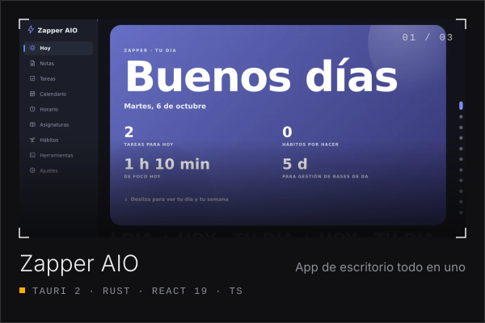
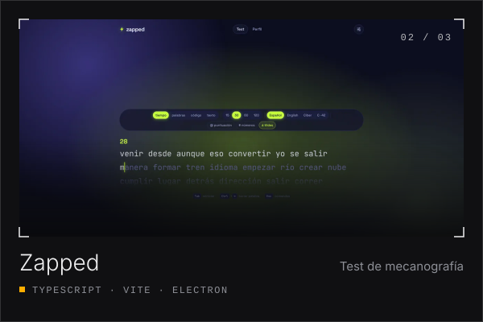
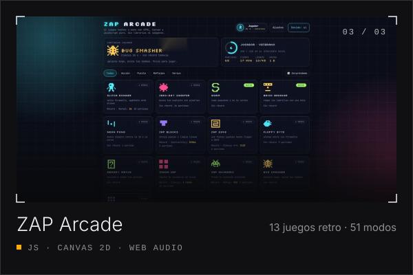

<a href="https://alvaro.sangon.eu">
  <picture>
    <source media="(prefers-color-scheme: dark)" srcset="assets/banner-dark.svg">
    <source media="(prefers-color-scheme: light)" srcset="assets/banner-light.svg">
    
  </picture>
</a>

  
  
  
  

## `01` · Sobre mí

Soy **Álvaro**, estudiante en Málaga con un objetivo claro: **la ciberseguridad**.
Empiezo por la base: sistemas, redes y programación en C.

- 🎓 **ASIR** en DigiTech Málaga (1.º, 2026–2028): redes, sistemas operativos, bases de datos y hardware.
- 🧩 **42 Málaga** (desde septiembre de 2026): C y aprendizaje entre iguales, sin profesores ni horarios.
- 🛠️ Diseño y publico **apps con IA**: la idea, el diseño, el contenido y las pruebas son míos; el código lo escribe Claude Code.
- 🖥️ Con ordenador desde los 7 años: instalo, configuro y arreglo Windows y Linux (y soy el soporte técnico de mi familia).
- 🧗 Fuera del teclado: escalada, deporte y videojuegos.

## `02` · Proyectos

<table>
  <tr>
    <td width="33%" valign="top">
      
       <b><a href="https://github.com/euZAPUS/zapper-aio-releases">Zapper AIO</a></b> · v0.11
       App de escritorio «todo en uno»: notas, tareas, calendario, horario, hábitos y foco con un huerto 3D. Sin internet ni suscripciones. Windows y Linux · 363 pruebas.
    </td>
    <td width="33%" valign="top">
      
       <b><a href="https://github.com/euZAPUS/zapped">Zapped</a></b> · v1.0.2
       Test de mecanografía con modos de tiempo, palabras, código y texto propio. Web + escritorio (Windows, macOS y Linux) · 38 tests.
    </td>
    <td width="33%" valign="top">
      
       <b><a href="https://github.com/euZAPUS/retro-zapp">ZAP Arcade</a></b> · v1.0.2
       13 juegos retro, 51 modos y 45 logros, con perfil, récords y XP. HTML + Canvas 2D + Web Audio, sin librerías.
    </td>
  </tr>
</table>

> [!TIP]
> Las tres tienen **demo jugable y tráiler** en mi portfolio: **[alvaro.sangon.eu](https://alvaro.sangon.eu/#projects)**.
> El propio portfolio también es público: **[zapium](https://github.com/euZAPUS/zapium)** (Astro + TypeScript + WebGL).

## `03` · Habilidades

| Nivel | |
| :-- | :-- |
| **Con soltura** | Terminal de Linux · arranque dual Windows/Linux · VirtualBox · Git y GitHub · instalar y configurar equipos |
| **Programación** | **C** (lo que más domino) · Python, HTML y CSS a nivel básico |
| **Aprendiendo** | Redes y subnetting · Cisco Packet Tracer · administración de sistemas |
| **Trabajo con IA** | Claude Code: defino qué quiero, reviso cada versión, pruebo y corrijo |

## `04` · Cómo trabajo con IA

**Yo pongo** la idea, el diseño, los textos y las pruebas. **Delego** en la IA la escritura del código.
**Reviso** cada versión a mano antes de publicarla. **He aprendido** a sincronizar proyectos con GitHub,
a diseñar animaciones y a escribir buenos prompts. Lo cuento así porque es como trabajo de verdad.

<b>🇬🇧 In English</b>

 

I'm **Álvaro**, a student in Málaga, Spain, aiming for **cybersecurity**.

- **ASIR** (IT systems & network administration) at DigiTech Málaga, 2026–2028, and **42 Málaga** since September 2026 (C, peer learning).
- I design and ship **apps built with AI**: the idea, design, content and testing are mine; Claude Code writes the code.
- Projects: **[Zapper AIO](https://github.com/euZAPUS/zapper-aio-releases)** (all-in-one offline desktop app), **[Zapped](https://github.com/euZAPUS/zapped)** (typing test) and **[ZAP Arcade](https://github.com/euZAPUS/retro-zapp)** (13 retro games). Playable demos at **[alvaro.sangon.eu/en/](https://alvaro.sangon.eu/en/)**.
- Skills: Linux terminal, dual boot, VirtualBox, Git · **C** (strongest), basic Python/HTML/CSS · learning networking, subnetting and Packet Tracer.
- English: B2–C1 (not certified yet).

---

  <code>&gt; alvaro.sangon.eu</code> · hecho con calma en Málaga · 🥔

